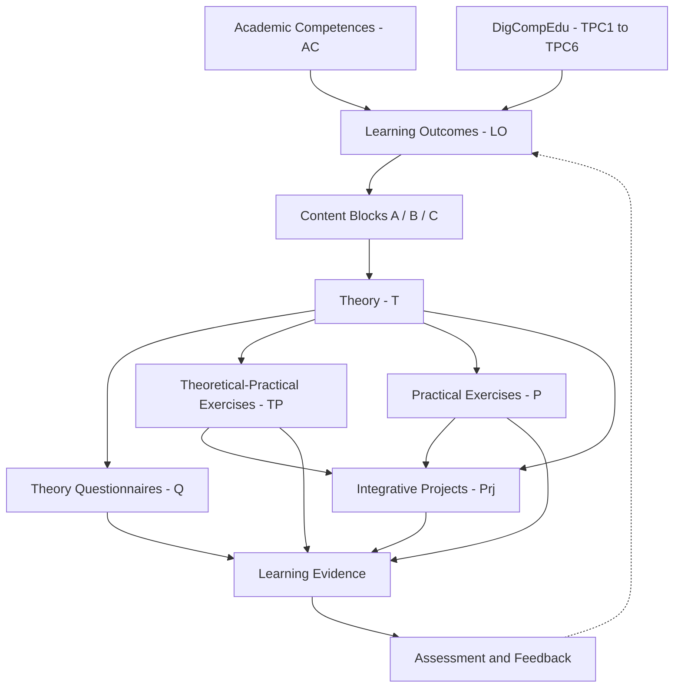

# PEDAGOGY.md — ICT in Primary Education

- **Academic year:** 2026–2027
- **Version:** 1.2
- **Last updated:** 2026-11-24
- **Status:** Core approved by the course teacher, updated with the selected documentation ecosystem, differentiated P/TP assessment and activity design decisions; focused teaching-team and institutional review actions remain open.
- **Scope:** English-medium group of the Bachelor's Degree in Primary Education (Trilingual), Faculty of Education — Bilbao, EHU.
- **Reference standard:** [PEDAGOGY.md 1.0](https://github.com/arceander/PEDAGOGY.md/blob/547f9322ccb4e6bd6fb22e675ac4be0691b0dc3a/PEDAGOGY.md), revision `547f9322ccb4e6bd6fb22e675ac4be0691b0dc3a` (including unreleased updates on selective modular adoption).

## Purpose and authority

This file is the central pedagogical specification of *Information and Communication Technology in Primary Education*. It defines the course identity, pedagogical principles, instructional logic and relationships between competences, learning outcomes, content, activities, assessment and feedback. It guides the teaching team, the development of teaching materials and the configuration of AI-supported educational systems.

The course design is maintained here across editions. The official course guide and applicable regulations govern institutional requirements; this file does not amend them. The teaching team uses the 2025–2026 assessment distribution as its planning model for 2026–2027, with the updated P and TP scoring conventions in section 9.4, as decided by the responsible teacher. The discrepancy with the published guide and the need for institutional alignment are recorded in sections 9 and 18. The Spanish-language guide's DigCompEdu-based content structure is adopted as the curricular reference for the course, with a request to align the other language versions in the following edition.

Repository documentation and student-facing materials are written in English. Internal discussions with the teacher may take place in Spanish. Outstanding decisions are concentrated in section 18 rather than distributed as status labels throughout the file.

## 1. Course Identity

| Field | Value |
|---|---|
| Course name | Information and Communication Technology in Primary Education |
| Course code | 27602 |
| Educational level | Undergraduate initial teacher education |
| Programme | Bachelor's Degree in Primary Education (Trilingual) |
| Institution | University of the Basque Country (EHU) |
| Faculty | Faculty of Education — Bilbao |
| Department | Didactics and School Organization |
| Teachers | Ander Arce Alonso and Javier Portillo Berasaluce |
| Language | English |
| Academic year | 2026–2027 |
| Year / semester | Second year, second semester |
| Course type | Compulsory |
| Group | 31-61, English-medium group |
| Credits | 6 ECTS |
| Modality | Face-to-face lectures and computer-based practical sessions, with autonomous work |
| Workload | 150 hours: 15 lecture hours, 45 practical hours and 90 hours of autonomous work |

### Course purpose

The course equips prospective primary school teachers with the knowledge, skills, resources and professional judgement needed to support children's participation in a digital society. It develops educators' digital competence, the capacity to design learning experiences and the ability to analyse the educational, social and ethical implications of technology.

Students should gain confidence in using unfamiliar tools, but technical proficiency alone is not the purpose of the course. They should learn to determine when technology contributes to teaching and learning, when it offers little benefit, and when a non-digital approach is preferable.

## 2. Educational Context

The course is part of initial teacher education and draws on students' first school placement. It connects with educational innovation, learning in digital environments and the semester's interdisciplinary work (DAL). Classroom, school and community situations provide contexts for application and transfer.

| Teaching mode | Face-to-face hours | Autonomous work hours |
|---|---:|---:|
| Lecture-based | 15 | 22.5 |
| Applied computer-based groups | 45 | 67.5 |
| Total | 60 | 90 |

Group allocation, classrooms and timetables follow the university's annual teaching schedule. The sequence of tasks, DAL periods and dates can change between editions and during the semester. No fixed calendar is imposed by this document.

**Learning environments.** eGela is the institutional environment for resources, instructions, submissions, grades and communications. Other tools may be used when their availability, access conditions, privacy and pedagogical value justify their use. DAL arrangements are coordinated with the relevant teaching team.

### Reference frameworks

- **DigCompEdu:** the primary framework for organizing curricular content and developing educators' professional digital competence (see sections 4 and 7).
- **DigComp:** a complementary framework for citizens' digital competence and for understanding the digital competence that future teachers should foster in primary school pupils. DigComp 3.0 is the reference for updating this dimension.
- **DigCompOrg:** a complementary perspective on the organizational integration of digital technologies in schools.
- **TPACK:** a framework for examining the relationships between technological, pedagogical and content knowledge and for justifying instructional design decisions.

These frameworks are used for distinct purposes rather than as interchangeable labels. The current versions of frameworks and relevant institutional or legal references should be checked when developing specific materials.

## 3. Learner Profile

Students are university learners preparing to become primary school teachers, with initial school placement experience. The course is taught in accessible academic English.

### 3.1. Experience of the previous edition

The teaching team's experience indicates that students generally experience the course as a varied and engaging sequence of practical tasks involving different tools, skills and challenges. Students with stronger digital competence tend to complete the tasks without major difficulty; those with less experience or confidence may require more guidance but generally manage to complete them. The classroom dynamic works well overall.

This variation is a strength when it encourages exploration and reduces apprehension about technology. However, a succession of engaging technical exercises may be experienced as disconnected unless students understand their common pedagogical purpose. Completing a task successfully does not necessarily demonstrate the ability to decide whether, when or how its associated technology should be used with children.

### 3.2. Expected needs and support

The following patterns guide scaffolding without assuming they apply to every learner:

- Differences in technical experience, confidence, autonomy and troubleshooting strategies.
- Reliance on familiar tools and difficulty evaluating alternative tools or non-digital approaches.
- Limited prior exposure to virtual learning environments and open professional learning opportunities.
- Difficulty translating theoretical frameworks into justified pedagogical decisions.
- Transition from personal technology use to the creation and evaluation of educational resources and AI assistants.
- Management of autonomous work, ongoing submissions and integration of learning in group projects.

Initial tasks, questions and classroom observation help identify prior knowledge and barriers. Support is adjusted progressively without labelling students by their technical fluency. Familiarity with social media, devices or applications is not equivalent to educators' digital competence.

## 4. Learning Outcomes and Competences

### 4.1. Academic Competences (AC)

The Spanish and English versions of the official guide retain five academic competences. The following local English formulations synthesize them; the identifiers remain stable for traceability.

| ID | Academic competence |
|---|---|
| AC1 | Critically analyse the social and educational impact of ICT, including its influence on family and school education. |
| AC2 | Understand and promote ICT-mediated interaction, communication and collaboration. |
| AC3 | Plan, develop and evaluate innovative technology-supported teaching and learning in formal education. |
| AC4 | Select, create and evaluate ICT-based learning materials for face-to-face and virtual settings. |
| AC5 | Develop a culture of lifelong learning and continuous professional development. |

### 4.2. DigCompEdu as the curricular competence framework

The course adopts the six areas of DigCompEdu as its primary curricular structure, following the theoretical and practical content section of the Spanish-language EHU guide. These areas complement the five official academic competences; they do not replace them administratively. The English-language guide currently retains a five-area DigComp-oriented content structure, which the teaching team intends to request be aligned for the next academic year.

The local identifiers `TPC1`–`TPC6` refer to the six DigCompEdu-based content areas from this edition onwards (see section 7). The identifiers have changed meaning relative to the five TPC codes of 2025–2026; historical mappings must not be reused without review.

### 4.3. Learning Outcomes (LO) — new for 2026–2027

The explicit learning outcomes below are a new element of this edition. They translate the course design into observable performances and are to be discussed and validated with Javier Portillo before they are used as definitive assessment or alignment requirements. They do not constitute new official competences or introduce additional grade weightings.

By the end of the course, students should be able to:

| ID | Learning outcome | Academic competences | DigCompEdu areas (main links) | Possible evidence |
|---|---|---|---|---|
| LO1 | Analyse the social and educational impact of digital technologies in a given educational situation, identifying opportunities, risks, barriers and appropriate responses. | AC1 | 5, 6 | Q, contextual analyses, practical tasks in C, exam, Prj3 |
| LO2 | Select and justify digital communication and collaboration practices appropriate to educational and professional contexts. | AC2 | 1, 3 | PLE/PLN, practical tasks in A, collaboration |
| LO3 | Design and justify a coherent learning sequence for primary education, aligning curriculum, pedagogy, technology and assessment, and evaluating digital and non-digital alternatives. | AC3 | 3, 4, 5 | Practical tasks in B, Prj2, exam |
| LO4 | Create or adapt digital educational resources and evaluate their pedagogical suitability, functionality, accessibility and ethical implications. | AC4 | 2, 5 | Practical tasks in B/C, Prj2/3 |
| LO5 | Identify, evaluate and use professional learning opportunities, reflecting on further professional development needs. | AC5 | 1 | Practical tasks in A, Prj1, reflection |
| LO6 | Make and explain responsible digital decisions, including source verification, privacy, intellectual property and critical use of artificial intelligence, and justify how these decisions support pupils' digital competence. | AC1–AC5 | 2, 5, 6 (cross-cutting) | Q, TP, P, projects, exam, as appropriate |

These links are indicative rather than exclusive. Activities may address several outcomes, and one outcome may require several kinds of evidence. Q primarily supports checking conceptual understanding; it does not by itself establish complex professional performance. The full mapping of activities and criteria should be developed after the teaching team validates the outcomes.

Expected performance involves understanding concepts and applying them with justification. More advanced performance integrates relevant evidence, alternatives, limitations and reflection. Formal performance levels are defined by the applicable assessment instruments.

## 5. Pedagogical Principles

The course adopts a constructivist orientation. Learning is an active process of constructing knowledge through application, experimentation, reflection and transfer to authentic or plausible teaching situations.

Technology is a means to educational ends, not an end in itself. Its educational value depends on the context, pupils, aims, methods and conditions of use. Technological integration is neither inherently beneficial nor inherently detrimental. The course does not promote technology uncritically or assume that every learning experience should be digital.

The following principles guide the course:

- **Theory–practice integration:** concepts and frameworks provide criteria for interpreting situations and making informed decisions.
- **Authenticity and transfer:** tasks connect to relevant responsibilities, challenges and products in primary education.
- **Progressive scaffolding:** manageable practical tasks build skills and confidence before more complex, integrative projects.
- **Autonomy and lifelong learning:** students develop strategies for exploration, information seeking, troubleshooting and professional development.
- **Critical techno-pedagogical judgement:** students compare digital and non-digital alternatives, examine the benefits and limitations of technology and justify decisions in relation to learning.
- **Digital responsibility:** decisions consider evidence, wellbeing, privacy, security, accessibility, equity and rights.
- **Collaboration and authorship:** students learn with others while retaining responsibility for their own understanding and contributions.

The course seeks to preserve the variety and practical character that engage students while strengthening reflection and conceptual coherence. Teachers should avoid reducing tasks to application tutorials, equating technical sophistication with educational quality or requiring technology when a simpler alternative better serves the learning aim.

Students develop a professional identity that goes beyond personal technology use and enables them to guide critical, safe, inclusive and healthy digital practices in primary schools and families.

## 6. Methodological Approach

### 6.1. Session types

**Theoretical sessions (one hour per teaching week).** These introduce concepts, frameworks and problems that provide a shared professional language. They typically combine a short connection to prior learning, conceptual exposition, a theory-related questionnaire (Q) and/or a brief theoretical-practical exercise (TP). Q is an occasional questionnaire at the end of a theoretical session, intended to foster attention and attendance and check understanding of the theory. Wooclap or eGela questionnaires may be used; weekly implementation will depend on feasibility. TP applies the concepts to a focused task. The specific combination and time allocation can vary with the session's aim.

**Practical sessions (three hours per teaching week).** These involve tool exploration, problem-solving, creation, analysis and instructional design. A typical session introduces its purpose, provides a brief conceptual or technical explanation, and allows guided work with a break when appropriate. Practical exercises (P) help students gain autonomy and prepare for the projects. Teachers connect the experience to educational decisions, including whether a technology is worth using in primary education.

**Autonomous work.** This includes engaging with resources, completing or improving activities, studying theoretical content and developing projects individually or collaboratively.

### 6.2. Instructional logic

The course moves from conceptual understanding to immediate application, contextualized practice and integrative projects. The addition of Q strengthens the link between theory and evidence of conceptual understanding without replacing TP or P.

| Relationship | Pedagogical function |
|---|---|
| AC / DigCompEdu → LO | Translate curricular expectations into observable learning (LO mapping subject to teaching-team validation). |
| Blocks → T, Q, TP, P and Prj | Provide a common conceptual purpose and prevent fragmented tasks. |
| T → Q | Check understanding of the theoretical content during the theoretical session. |
| T → TP | Apply a concept directly to consolidate understanding. |
| T → P | Use theory as a lens for interpreting practical situations rather than simply repeating it. |
| T → Prj | Integrate concepts from several topics to support complex professional decisions. |
| TP / P → Prj | Scaffold the knowledge, tools and criteria needed for project work. |
| Evidence → Assessment and Feedback | Identify learning, inform improvement and adjust support. |

The conceptual relationship does not require every practical task to reproduce that week's theory. Topics can be revisited when useful. Q is not automatically a summative assessment component; its grading and completion rules are distinguished from the instructional logic in section 9.

Teaching combines individual work, collaboration, guided practice, inquiry, design and reflection. AI use is determined by the learning purpose and the instructions for each activity.

## 7. Content Organization

### 7.1. Theoretical and Practical Content (TPC)

The primary curricular structure is the six-area DigCompEdu organization adopted from the Spanish-language course guide. The following scope statements summarize the areas in English.

| ID | DigCompEdu area | Scope in the course |
|---|---|---|
| TPC1 | Professional Engagement | Professional communication, collaboration, reflective practice and digital professional development. |
| TPC2 | Digital Resources | Selecting, creating, adapting, managing and sharing educational resources responsibly. |
| TPC3 | Teaching and Learning | Designing and supporting instruction, guidance, collaboration and self-regulated learning. |
| TPC4 | Assessment | Using digital approaches to gather and interpret evidence and support feedback and planning. |
| TPC5 | Empowering Learners | Accessibility, inclusion, differentiation, personalization and active participation. |
| TPC6 | Facilitating Learners' Digital Competence | Information and media literacy, communication, content creation, responsible use and digital problem-solving. |

DigComp remains a complementary framework, particularly within TPC6. The six areas do not prescribe six sequential teaching blocks. They are integrated across the course's three conceptual blocks and cross-cutting dimensions.

### 7.2. Conceptual architecture

| Block | Name | Purpose | Main alignment |
|---|---|---|---|
| A (green) | Personal, Professional and Organizational Use of ICT | Build personal, professional and organizational digital competence. | AC2, AC5; LO2, LO5; TPC1 |
| B (blue) | Techno-Pedagogical Design | Design, create and evaluate learning experiences and resources, including informed selection of technology. | AC3, AC4; LO3, LO4; TPC2, TPC3, TPC4 |
| C (orange) | Critical and Ethical Use of ICT | Analyse the opportunities, risks and responsible uses of technology. | AC1, AC4; LO1, LO4, LO6; TPC5, TPC6 |

**Block A.** Professional digital identity; personal learning environments and networks (PLE/PLN); lifelong learning; online and open learning (MOOC, NOOC, SPOOC); learning management systems (LMS); professional and organizational ICT use in schools.

**Block B.** TPACK; relationships between technology, didactics and curriculum; computational thinking and programming; maker methodology, makerspaces and Ikaslab; digital resource selection and creation; techno-pedagogical design and assessment.

**Block C.** Knowledge society and digital divide; opportunities and risks of technology; cyberbullying and device use; digital wellbeing; web evolution and AI; critical digital citizenship.

**Cross-cutting dimensions.** TPC4–TPC6, LO6, information and media literacy, accessibility, intellectual property, privacy and sustainability are addressed wherever they support the intended learning. AI may be studied and used across all three blocks, with explicit critical and ethical treatment in C. Critical comparison of digital and non-digital alternatives is a course-wide principle.

### 7.3. Teaching route and annual planning

The usual route includes an introduction to the digital competence frameworks, progressive development of A, B and C, DAL periods, and a closing and integration phase. Topics, sessions and resources may be rearranged, revised or replaced during the year. The conceptual architecture is distinct from the edition-specific schedule; neither the number of activities nor the exact topics in a particular week are fixed here.

Teaching weeks are referred to locally as `S1`, `S2`, `S3`, etc. `S1` corresponds to academic week 16 in the EHU calendar for this edition. The annual schedule records the actual calendar correspondence and any interruptions or changes. See section 8 for activity naming.

## 8. Learning Activities

### 8.1. Activity types and naming

| Code | Type | Function |
|---|---|---|
| T | Theory | Conceptual foundation of a block. |
| Q | Questionnaire | Theory-related questionnaire completed during a theoretical session, introduced in 2026–2027. |
| TP | Theoretical-Practical exercise | Brief, usually individual task applying theoretical content directly. |
| P | Practical exercise | Applied task developed in practical sessions; analysis, exploration, design, creation or problem-solving. Previously referred to as PS. |
| Prj | Project | More complex integrative task, normally developed in teams. |
| R | Resource | Supporting reading, tool, guide, media or other material. |
| DAL | Interdisciplinary work | Coordinated interdisciplinary module work. |

The weekly naming convention uses `<type>_S<week>`: for example, `P_S5` is the practical exercise for course week 5, and `Q_S9` is the questionnaire for course week 9. Similarly, `TP_S5` is the theoretical-practical exercise for week 5. A suffix may be introduced if several exercises of the same type occur in one week, only where needed. Project identifiers remain `Prj1`, `Prj2`, `Prj3`. Theory and resource identifiers may use the same week convention when helpful; reusable materials need not be permanently tied to a week.

`PS` is a historical activity code and may appear in previous materials. `P` is used for current practical exercise identifiers and assessment references. Historical materials should be checked before reuse rather than silently renamed. Week-based identifiers refer to the course edition, not stable conceptual identities. Reusable activities have a permanent internal identifier (`ACT-001`, `ACT-002`, etc.) allocated when registered. Student-facing codes such as `P_S2` remain the normal way to refer to activities in class. The edition teaching route maps the weekly code to the permanent activity identity and revision; moving an activity to a different week does not change its permanent ID.

### 8.2. Integrative projects

One project per block remains the planning model. The three project designs below are retained for the current edition but must be reviewed with Javier Portillo, as their scope or format may change. Project-specific briefs establish the final tools, grouping, outputs and criteria. Each project has a dedicated workspace under `projects/`, with its brief, guides, resource links and, when developed, its assistant specification and tests. The authoritative rubric is linked rather than duplicated.

| Project | Purpose | Reference task and output | Main LO links |
|---|---|---|---|
| Prj1 — Self-training (A) | Develop a culture of self-directed professional learning and evaluate training opportunities. | Complete one or more MOOC/NOOC/SPOOC courses, with INTEF as a reference; submit evidence and reflect on learning, primary education applications and professional improvement. | LO2, LO5 |
| Prj2 — Techno-Pedagogical Design (B) | Demonstrate instructional judgement and curriculum integration. | Design a three-session sequence (one hour per session) combining computational thinking with another curricular competence or topic; produce an explanatory video and justify the design, including the role and suitability of technology. | LO3, LO4 |
| Prj3 — Playlab (C) | Apply critical and ethical judgement to AI assistant design and digital wellbeing. | Develop an AI assistant prototype for students or teachers at the faculty, documenting its purpose, audience, limitations, responsible use and interaction examples; present it in an app exhibition. | LO1, LO4, LO6 |

A tool is not itself a learning outcome. Platforms may be replaced where equivalent evidence can be produced. A digital wellbeing prototype must not be presented as a diagnostic service or a substitute for professional care. The specific grouping of Prj1 and the individual contribution evidence for group projects should be established in the project briefs.

### 8.3. Activity design and learning evidence

Activities should specify, in proportion to their complexity:

- Purpose, relevant content and intended learning.
- Task, context, resources and grouping.
- Observable output or evidence of learning.
- Quality criteria and assessment relationship, where relevant.
- Conditions of AI use.
- Submission deadline and format.

Each reusable TP or P has two complementary layers: an internal activity specification for teachers and AI, and a student-facing brief for Word and eGela. The internal specification records stable identity, revision, block, activity type, pedagogical rationale, relevant content and AC/TPC/DigCompEdu mappings, provisional LO links where relevant, observable evidence and criteria, and optional links to related activities or projects, scaffolding and teacher notes. The student-facing brief contains only the information needed to understand and complete the activity, including learning objectives, visible curricular links, instructions, expected output, success criteria, AI-use conditions and submission requirements as applicable. Edition-specific dates and weekly codes are maintained in the annual route and supplied to the published brief. Both layers share the same student-facing content; internal notes must not introduce undisclosed assessment criteria. A common modular template serves P and TP, with detail proportional to complexity. The selected design uses yellow activity headings and a textual block label with the corresponding block colour, subject to accessibility and Word-to-eGela testing. See [documentation ecosystem](docs/documentation-ecosystem.md) for the planned templates and implementation sequence.

Internal design records can include pedagogical reasoning and mappings; student-facing instructions must be concise, clear and sufficient to complete the task. Q should be designed around conceptual understanding of the theory. TP and P should make the transition from operating tools to making pedagogical decisions visible. Where relevant, tasks ask students to explain the value or limitations of a tool and compare it to alternatives rather than merely demonstrate its operation.

**Submission deadlines.** Some exercises are due by the end of the session; others have a maximum deadline of six days, normally until 23:59 on the day before the corresponding weekday in the following week. The effective deadline is specified in each exercise. Q is completed during the theoretical session. Project deadlines are specified in their briefs.

Activities may be revised, replaced and reused across editions. Scenarios and cases are embedded within activities, projects and assessment where useful; they do not form a persistent independent case system.

## 9. Assessment Design

### 9.1. Assessment principles

Assessment collects evidence of conceptual understanding, practical application, creation, techno-pedagogical design, critical reflection and digital responsibility. It combines formative assessment throughout the learning process with summative assessment of demonstrated learning. Initial observation and tasks help identify support needs.

Completing an activity is not equivalent to demonstrating learning. Assessment should distinguish between technical execution and the ability to make justified professional decisions. Learning outcomes, once validated, guide the design of tasks and criteria without independently altering the weighting of the course components.

### 9.2. Continuous assessment: weighting

The course retains the 2025–2026 assessment distribution as the teacher's decision for the 2026–2027 edition. P and TP use the distinct scoring conventions specified in section 9.4.

| Component | Weight | Distribution |
|---|---:|---|
| Exam | 21% | Individual theoretical-practical written examination |
| P — individual practical exercises | 33% | 11% per block (A, B, C) |
| Prj — projects | 30% | 10% per project (Prj1, Prj2, Prj3) |
| DAL | 16% | According to interdisciplinary assessment arrangements |
| TP — theoretical-practical exercises | No direct weighting | Required learning activities |
| Q — theory questionnaires | No separate weighting allocated | Conceptual checks during theoretical sessions; see section 9.4 |
| **Total** | **100%** | |

**Institutional alignment.** The published 2026–2027 Trilingual Primary Education guide currently specifies 30% written examination, 70% practical work and a 100% individual test in final assessment. The responsible teacher identifies the published discrepancy as an error and has selected the previous edition's 21/63/16 model for course planning. This decision does not itself amend the published guide. The discrepancy must be addressed through the appropriate institutional procedure and applicable requirements respected before assessment conditions are communicated as official or applied to grades. The guide of the non-trilingual degree is not the source of authority for this group. See the source record and maintenance actions in section 18.

### 9.3. Continuous assessment: participation and progression

Continuous assessment is the ordinary course model. Attendance at theoretical and practical sessions is compulsory within this model. Students must complete all TP and P exercises required for the corresponding block to access its project and complete all blocks to access the examination. TP activities are required even though they carry no direct numerical weighting. Q is incorporated into theoretical sessions as an additional learning activity; any consequence of non-completion for progression or grading must be defined before its application (see section 18).

Attendance, justified absences, remediation and eligibility requirements must be interpreted and communicated consistently with institutional rules, including the right to final assessment. No unannounced attendance threshold, automatic exclusion or additional penalty should be inferred from this document. Conditions and opportunities for making up missed work are to be made clear to students.

### 9.4. Assessment instruments

**Exam.** The previous examination format is retained. It contributes 21% of the final grade in the continuous assessment model.

| Part | Internal weight | Format |
|---|---:|---|
| Theoretical | 50% | Multiple-choice questions with four options; incorrect answers do not subtract points. |
| Practical | 50% | Two exercises: explanation of a theoretical concept in an open format and resolution of a practical situation according to the instructions. |

To pass the examination, students must both achieve at least 66% correct answers in the theoretical part and obtain an overall examination mark of at least 5/10. The examination assesses individual conceptual understanding and application. The practical part can require students to justify both technology use and the decision not to use it.

**P — practical exercises.** The responsible teacher has selected the four percentage levels used in the 2025–2026 activity template: `0`, `33`, `66` and `100`. The purpose is to distinguish intermediate work from work that fully meets the expected standard. The following general quality descriptors are working operational formulations; activity-specific success criteria make them observable.

| Score (%) | Working quality descriptor |
|---:|---|
| 0 | No submission or no assessable evidence of the required learning. |
| 33 | Some relevant evidence, but substantial errors or omissions relative to the success criteria. |
| 66 | Adequate evidence of the intended learning, with identifiable limitations or aspects needing improvement. |
| 100 | The work fully meets the communicated success criteria and expected standard. |

**TP — theoretical-practical exercises.** Use a binary completion scale: `0` or `100`. A TP is a required learning activity without direct numerical weighting in the final course grade. The following working descriptors distinguish completion from non-completion; the minimum evidence required is made explicit in the instructions.

| Completion score (%) | Working descriptor |
|---:|---|
| 0 | Not completed: no submission or required minimum evidence not demonstrated. |
| 100 | Completed: the required minimum evidence of the activity has been demonstrated. |

P exercises contribute to the grade of their respective block; TP records track completion and do not directly contribute to the numerical grade. Deadlines remain activity-specific (end of session or up to six days). Distinguish learning quality, completion and punctuality in the evidence and feedback. The historical four-level template combined punctuality and quality; the teacher has selected its four numerical levels, not reinstated the overlapping historical descriptors. The precise effect of late work (including justified late submissions), P aggregation, TP completion thresholds and remediation/progression procedures remain subject to review and must be communicated consistently within institutional requirements before application. No new late penalty or progression threshold is established here.

**Q.** Questionnaires are a new instrument for checking understanding at the end of selected theoretical sessions, encouraging attention and attendance, identifying misconceptions and informing teaching and examination preparation. They may be delivered through Wooclap or eGela questionnaires. Their use every week is not a fixed requirement. No separate summative weighting is introduced, thereby preserving the agreed assessment distribution. The precise format, scoring or completion record, make-up arrangements and any relationship to TP or progression requirements are to be agreed before being used as assessment conditions. A Q result must not automatically be treated as a P or TP grade.

**Prj.** Each project is assessed through a specific rubric linked to its evidence and relevant learning aims. The working numerical convention is five performance levels, scored 0–4, based on the explicit scale in the 2025–2026 document. The mean of equally weighted rubric criteria, where that design applies, is converted to a 0–100 scale (`mean / 4 × 100`). Specific descriptors and any criterion weights must be defined in each rubric. This convention resolves the historical inconsistency between the heading “1–5” and the description “0–4”; it is recorded for final review in section 18. Grouping and evidence of individual contributions are specified in project briefs.

**DAL.** Interdisciplinary work contributes 16% of the course grade and follows the assessment criteria and procedures established by the interdisciplinary teaching team.

### 9.5. Final assessment and extraordinary call

Students may withdraw from continuous assessment in accordance with the EHU regulations and the applicable deadlines and procedures. The general period for withdrawal is nine weeks from the start of the semester, subject to applicable institutional provisions. Withdrawal from continuous assessment and withdrawal from an assessment call are different procedures.

The selected final assessment model retains the previous distribution:

| Component | Weight |
|---|---:|
| Final individual examination | 84% |
| DAL | 16% |
| **Total** | **100%** |

In the extraordinary call, students who followed continuous assessment retain the grades of components they have passed and must complete the outstanding components. Failed or incomplete coursework must be submitted and defended; a failed examination is retaken through the corresponding examination procedure. The exact submission dates, defence format and recovery instructions are communicated by the teachers. The treatment of DAL is coordinated with the relevant team. The final assessment route uses the 84/16 planning model, subject to the institutional alignment noted in section 9.2.

The teaching team retains responsibility for official grades, eligibility decisions, exemptions and academic integrity procedures. AI may support the review of evidence and criteria, but does not establish assessment rules or determine official marks.

## 10. Feedback Model

### 10.1. Current feedback practice

Feedback is primarily provided through eGela and through guidance during classroom work. Routine exercises normally receive a grade or completion result in eGela rather than a systematic individualized written comment. Students who disagree with a grade or need clarification approach the teacher to discuss their work. Classroom guidance helps resolve technical and conceptual difficulties while tasks are being carried out.

Projects receive more specific individualized or group feedback because of their complexity and greater assessment weight. The teachers use the project criteria, evidence and observed difficulties to explain the grade and guide improvement. This description reflects the current model; it does not imply that every routine task receives written formative feedback.

### 10.2. Feedback principles and possible improvements

Feedback should help students recognize what their work demonstrates, identify weaknesses and decide how to improve. A practical structure, when detailed feedback is appropriate, is **observed evidence → achievement → priority for improvement → concrete next step**. Comments may be oral or written, individual, group-based or collective.

Direct correction is appropriate when a technical or conceptual error prevents further learning. Hints, questions and alternative examples are useful when the student should discover or justify a solution independently. Particular attention should be paid to the distinction between successful tool operation and sound pedagogical reasoning. Q responses can inform collective clarification of misconceptions; no individualized written feedback is assumed for every questionnaire. Peer and self-assessment may be incorporated where they support reflection and revision.

AI-mediated feedback and assessment support are possible developments, not established practices for this edition. The two-layer activity specification provides a basis for criterion-referenced review of evidence and for student-facing formative assistants. Possible pilots include a teacher-facing assistant that identifies evidence against published criteria and drafts feedback for teacher review, or a student-facing assistant used before submission to identify potential errors, ask guiding questions and support revision without completing the task for the student. A selected activity may eventually require such a formative interaction if its purpose, access arrangements, evidence, permitted assistance and alternatives are explicitly defined and approved beforehand. Any pilot should protect personal data, specify teacher review and evaluate accuracy, usefulness, fairness and workload. AI must distinguish observed evidence from inference, flag uncertainty, avoid invented observations or undisclosed criteria, and never issue official grades or make binding progression decisions. No automated grading, mandatory assistant use or feedback workflow is adopted at this stage.

## 11. Quality Criteria for Student Work

The quality of student work is evaluated in relation to its purpose, intended learning and applicable assessment criteria. The following cross-cutting dimensions guide activity and rubric design; they do not automatically constitute additional graded criteria or weights.

| Dimension | Quality indicator |
|---|---|
| Conceptual accuracy | Appropriate understanding and application of concepts and frameworks. |
| Pedagogical judgement | Justified technology decisions based on the learning purpose, curriculum, pupils and context, including consideration of non-digital alternatives. |
| Instructional coherence | Alignment of aims, activities, resources, learning evidence and assessment. |
| Technical quality | Functionality and suitability of the product for its purpose. |
| Evidence and sources | Critical selection, verification and acknowledgement of relevant information and resources. |
| Accessibility and inclusion | Attention to learner diversity and participation barriers. |
| Ethics and responsibility | Privacy, intellectual property, safety, wellbeing and responsible AI use. |
| Reflection and autonomy | Ability to explain decisions, recognize limitations and propose improvements. |
| Communication | Clarity, organization and suitability for the intended audience. |
| Authorship and collaboration | Responsibility for one's own work and meaningful contribution to collective work. |

A sophisticated or visually appealing digital product is insufficient evidence if the student cannot understand and explain the decisions behind it. Conversely, a simple or non-digital solution may demonstrate excellent pedagogical judgement where it is justified and compatible with the task's intended learning. Technical requirements remain relevant when the task explicitly assesses technical competence. Specific criteria are communicated in activity instructions or rubrics before assessable work is undertaken. For P and TP, use a small set of observable activity-specific success criteria (normally two to five where appropriate); for TP identify the minimum evidence for completion. These criteria support self-assessment, feedback and consistent teacher judgement without requiring a separate analytic rubric for every routine exercise.

## 12. Roles and Responsibilities

**Teachers.** Design learning experiences, introduce conceptual frameworks, scaffold practical work, model critical and responsible technology use, and assess student learning. Coordinate groups and DAL, maintain resources and retain responsibility for all pedagogical and academic decisions. Ensure students are not merely trained to operate tools but learn to assess their educational value.

**Learners.** Participate actively, complete the required questionnaires and exercises, engage in group projects and take responsibility for autonomous work. Verify the quality of outputs, reflect on their choices and justify the educational relevance of their decisions. Use AI within activity-specific conditions and remain responsible for authorship and learning.

**AI supporting teachers.** Assists with planning, activity and resource design, review, rubric development and documentation maintenance. It does not replace professional judgement or transform proposals into academic agreements.

**AI supporting learners.** May explain, guide practice, support design or provide formative feedback where authorized for a defined educational purpose. It does not replace the independent performance required by an activity. Assistants created as project products have a distinct purpose and do not automatically become institutional services.

## 13. AI Use Policy

### 13.1. Contextualized use

AI is both an object of study and a tool for learning, design and creation. The course adopts a contextualized AI-use model: permitted, restricted, required or prohibited uses are determined by the learning purpose and evidence required in each activity. There is no universal authorization to delegate coursework to AI, and no blanket prohibition on pedagogically justified AI use.

| Category | Conditions and examples |
|---|---|
| Permitted support | Concept clarification, alternative ideas, practice, language revision, code troubleshooting or comparison of solutions, where compatible with the task. |
| Restricted use | Generating substantial parts of products, code, reflections or pedagogical decisions when these are the performance to be assessed. Instructions specify what may be delegated and what must be done independently. |
| Integrated or required use | Designing, configuring or testing AI assistants; critically analysing generated outputs, where these processes are themselves the learning task. |
| Prohibited use | Misrepresenting authorship, fabricating sources or evidence, circumventing assessment conditions or breaching privacy and data protection requirements. |

Q, TP, P and project instructions specify AI conditions as relevant. In questionnaires that assess individual understanding, AI must not supply answers unless the learning design expressly permits it. In examinations, AI use requires express authorization consistent with the assessment conditions. Where an activity is silent, students must not assume that delegation of assessable reasoning is permitted and should seek clarification if needed.

Students remain responsible for checking accuracy, adapting outputs and understanding and justifying their decisions. AI-generated claims, resources or references must be verified where relevant. The policy aims to develop independent judgement rather than uncritical reliance on AI.

### 13.2. Transparency and acknowledgement

Where AI contributes materially to assessable work, activity instructions may require a declaration of the tool, purpose, processes or sections affected, contribution and limitations, verification undertaken and decisions made by the student. Distinguish activity-level authorization (permitted, restricted, required or prohibited) from acknowledgement and critical reflection; communicate the conditions in the brief, including any phase-specific limitations. The precise level of detail is proportionate to the activity and communicated in advance. Complete conversation histories are not requested by default. AI acknowledgement does not replace citation of relevant sources.

### 13.3. Privacy, integrity and accountability

Identifiable or sensitive personal information relating to children, families, schools, peers or teachers must not be entered into services that are not authorized for such processing. Fictional, synthetic or appropriately anonymized data are used when sufficient for the learning task.

Teachers supervise materials, tools and assessment decisions. Academic integrity concerns are addressed through applicable procedures and disclosed criteria; AI detection scores alone do not establish misconduct. The person using AI retains responsibility for the final output. Activity-level authorization must be consistent with institutional requirements.

## 14. AI Agent Behaviour

### 14.1. Teacher-facing assistant

The course assistant acts as a pedagogical collaborator, instructional designer and resource editor. It should:

- Consult the relevant documentation and distinguish the course design from institutional requirements.
- Maintain alignment between AC, DigCompEdu/TPC, LO, content, Q/TP/P, projects, assessment and feedback.
- Produce repository documentation and student-facing materials in English; use Spanish for internal discussion with the teacher unless requested otherwise.
- Adapt format, scope and complexity to the recipient and purpose.
- Preserve validated content during revision; identify implications for other documents or activities.
- Distinguish documented decisions from inferences, suggestions and unresolved matters; never invent evidence, requirements, references or grades.
- Verify external sources when relevant, protect data and flag significant contradictions.
- Encourage critical comparison of technology-supported and non-digital pedagogical alternatives rather than assuming technology must be used.

When a decision affects assessment, institutional obligations or AI-use restrictions and cannot be resolved from the available documentation, the assistant should request or defer to teacher judgement.

### 14.2. Student-facing assistants

Student-facing assistants are likely to be developed progressively during the edition, particularly for the projects. Their purposes and deployment are decided as needs emerge. No particular assistant or platform is presumed to be available to students simply because it is described here.

Each assistant should have a defined purpose, scope, authorized knowledge sources, permitted actions and boundaries. Possible functions include clarification of concepts, practical troubleshooting, support for design decisions, critical review of projects and formative feedback. Responses should be accessible to undergraduate prospective primary school teachers, use relevant examples, provide scaffolding and preserve students' responsibility for reasoning and authorship.

Assistants should offer hints or guiding questions when direct answers would undermine learning, explain uncertainty and limitations, and avoid invented course requirements or references. They must not complete tasks against their instructions, issue official grades, claim authority over assessment rules or process unauthorized personal data. Assessment disputes, wellbeing issues beyond the assistant's competence and institutional questions should be referred to the teacher or the appropriate service.

Each assistant is reviewed before deployment, especially where it relates to assessable project work. Feedback-specific assistants require a separately designed workflow before systematic use (section 10).

## 15. Inclusion and Accessibility

Differences in digital experience, language proficiency, access to resources and support needs inform activity design. Accessibility applies both to course materials and to the educational products students create.

Materials should use clear language, logical structure, adequate contrast, textual alternatives to visual information, captions where relevant and accessible formats. Instructions and examples should reduce unnecessary barriers without reducing the conceptual demands of the course.

Where access to devices, accounts, tools or licences is problematic, feasible alternatives that allow equivalent learning evidence should be considered. Dependence on paid services or tools requiring personal data should be avoided without pedagogical justification and suitable alternatives.

Support is adjusted to students' digital competence while preserving learning aims and recognized institutional accommodations. AI may contribute to accessibility where authorized and pedagogically appropriate, without compromising privacy or the independent performance being assessed. Students are expected to consider the accessibility and inclusiveness of both digital and non-digital educational alternatives.

## 16. Learning Evidence and Analytics

Relevant learning evidence includes Q responses, TP and P submissions, individual and group products, design rationales, reflections, classroom observations, revisions, examinations and project defences. eGela records may provide complementary information for tracking submissions and results.

Indicators of activity (accesses, completion or submissions) must be distinguished from indicators of learning (understanding, application, quality of decisions and the ability to justify them). Neither engagement, competence, misconduct nor motivation should be inferred automatically from activity metrics. Q results may reveal patterns of conceptual difficulty; practical and project evidence provides complementary insights into application and professional reasoning.

The purpose of reviewing evidence is to identify support needs, adjust scaffolding, assess the suitability of tasks and improve future editions. Data should be proportionate and, where possible, aggregated. Identifiable student evidence must not be published in GitHub. Private AI interactions are not monitored or collected without a defined purpose and applicable authorization.

No automated learning analytics system is adopted. Any further development should address a concrete pedagogical need, respect privacy and retain human oversight.

## 17. Related Files and Modular Extensions

This PEDAGOGY.md is the central reference. Complementary documentation is adopted selectively when the amount of information, frequency of revision or practical use justifies separation. The standard does not require a fixed directory structure or empty modules.

### 17.1. Existing sources and operational environments

| Document or environment | Function |
|---|---|
| This PEDAGOGY.md | Central course design and alignment specification. |
| ICT_25.26_System promt asignatura.docx | Historical design source, not a current operational specification. |
| EHU course guide and assessment regulations | Institutional curriculum, requirements and assessment authority. |
| eGela | Operational materials, submissions, feedback, grades and student communications. |
| DAL documentation | Interdisciplinary coordination and requirements. |

### 17.2. Repository development and module selection

The selected modular ecosystem is described in [Documentation ecosystem](docs/documentation-ecosystem.md), including module responsibilities, relationships, identifiers, maintenance and the implementation sequence. The intended co-design environment is private to the teaching team; actual GitHub visibility and access settings must be verified separately. eGela remains the operational environment for student work and communications. No identifiable student records belong in the repository, even when private.

| Module | Function | Implementation status |
|---|---|---|
| `PEDAGOGY.md` | Central pedagogical reference | Core established; v1.2 update |
| `README.md`, `CHANGELOG.md`, `docs/documentation-ecosystem.md` | Navigation, substantive change history and architecture | Available |
| `content.md` and, where useful, `content/` | Stable conceptual architecture and detailed content | Selected; develop following theory-material review |
| `ontology.md` | Concept definitions and meaningful relationships | Selected; preliminary version during the course, review at the end of the edition |
| `activities.md`, `activities/` | Reusable activity register and briefs; permanent internal IDs | Selected; populate from reviewed activities |
| `docs/activity-design-guidelines.md` | Internal guidance for teacher and AI design and review of P/TP | Available; v0.1 teacher-approved for pilot |
| `activities/templates/activity-template.md` | Internal activity specification with a reusable student-facing layer | Agreed; next development phase |
| `activities/templates/activity-template.docx` | Editable student-facing representation for Word and eGela | v2.0 teacher-approved; binary upload and eGela pilot pending |
| `projects/` | Dedicated project workspaces including guides, resources and assistants when available | Selected; project decisions remain subject to review |
| `assessment.md`, `rubrics/` | Detailed assessment implementation and authoritative rubrics | Selected; develop with verified criteria and instruments |
| `resources.md`, and `resources/` when justified | Verified resource catalog, pedagogical value and limitations; local assets as needed | Selected catalog; local storage conditional |
| `editions/2026-2027/teaching-route.md` | Flexible weekly route, activity placement and annual changes | Selected location; develop with annual planning |

The conceptual structure is distinct from the annual teaching route. Stable activity IDs remain distinct from the weekly identifiers communicated to students. The six resource categories are frameworks, scientific literature, institutional resources, digital tools, learning resources and AI tools. Each resource should record its pedagogical purpose and relevant conditions or limitations, not merely its availability.

A persistent `cases.md` or `cases/` system is explicitly not adopted. Scenarios and cases can be embedded directly in tasks or assessments. AI policy and feedback remain in the core unless a concrete need justifies separate extensions. Project-specific assistant specifications belong with the corresponding project. The documentation architecture does not require creating empty modules or directories; planned entries do not imply existing files.

## 18. Versioning and Maintenance

### 18.1. Maintenance principles

Review this file before each edition and when significant changes affect competences, learning outcomes, content architecture, methodology, assessment, AI policy, resources or institutional conditions. Routine changes to weekly scheduling, activities and tools should be maintained in the relevant operational materials, not necessarily in the core file.

The teachers validate substantive changes. Check implications for course materials, eGela instructions, rubrics, activities, resources and assistants before implementing changes. Preserve useful identifiers and document migrations that may affect existing mappings. Maintain traceability without unnecessary administrative effort. Repository documentation remains in English across editions.

### 18.2. Version history

| Version | Date | Changes |
|---|---|---|
| 2025–2026 source | 2026-01-23 | Course design and context document preceding adoption of the standard. |
| 0.1 | 2026-11-24 | Migration to the 18-section PEDAGOGY.md structure; initial institutional comparison and development of outcomes, feedback, AI, inclusion and evidence. |
| 0.2 | 2026-11-24 | Consolidated specification; removal of distributed status labels; open decisions collected in section 18. |
| 0.3 | 2026-11-24 | Incorporated the teacher's decisions for 2026–2027; converted the entire specification to English; adopted DigCompEdu as the primary curricular content structure; introduced Q and weekly S identifiers; updated LO mapping and instructional diagram; retained assessment weights and exam format; clarified deadlines, recovery, learner experience, critical pedagogy, AI use and actual feedback practice. |
| 1.0 | 2026-11-24 | Adopted version 0.3 as the initial repository baseline with the course teacher's approval; retained all open teaching-team and institutional review actions. |
| 1.1 | 2026-11-24 | Local project revision: selected ecosystem, private co-design intent, permanent activity IDs, project workspaces, resource categories and Q delivery; retained assessment weights and unresolved review actions. |
| 1.2 | 2026-11-24 | Integrated v1.1 architecture into the repository; adopted four P levels (0/33/66/100) and binary TP completion (0/100); agreed two-layer activity design, template architecture and a prospective AI-assisted review/feedback approach. |

### 18.3. Focused review and implementation actions

The following matters are distinct from the agreed core design. They should be addressed with the teaching team or during implementation, at the appropriate time.

| Matter | Action |
|---|---|
| New learning outcomes | Discuss LO1–LO6 and the proposed DigCompEdu alignment with Javier Portillo. Review outcome coverage and evidence before adopting definitive mappings and assessment criteria. |
| Projects | Review Prj1–Prj3 with Javier Portillo; confirm grouping (particularly Prj1), deliverables, tools, individual contributions and any redesign. |
| Course guide alignment | Request alignment of the language versions with the DigCompEdu content structure for the next edition; address the 30/70 and 100% final-assessment discrepancies with the selected 21/63/16 and 84/16 course models through applicable institutional procedures. The precise status of any official correction is not established by this file. |
| Q implementation | Trial occasional end-of-lecture questionnaires in Wooclap or eGela and evaluate the feasibility of weekly use. Define format, scoring/completion record, recovery arrangements and whether completion affects progression. No separate grade weighting has been assigned. |
| Assessment implementation | Implement the selected four-level P and binary TP scales after review of operational descriptors and minimum completion evidence. Confirm the 0–4 five-level project rubric convention, aggregation of P grades, recovery/defence logistics, arrangements for justified absences and late work, and component pass/retention rules within institutional requirements. |
| Annual schedule | Develop and adjust the S-week route, DAL periods, activity selection and dates as needed. |
| AI-supported projects, feedback and assessment support | Develop student-facing assistants as needs emerge, especially for projects; consider separate, supervised pilots for criterion-referenced teacher review and student pre-submission guidance. Any required assistant interaction needs explicit activity-level approval and suitable access, privacy and verification arrangements. |
| Activity design | The student-facing Word template v2.0 is teacher-approved; upload the original binary, review the corresponding Markdown specification, then pilot with a short TP, a technical P and a complex AI-related P; validate Word-to-eGela transfer before adoption and repository incorporation of the revised templates. |
| Repository | Implement the selected ecosystem progressively. Restrict access to the teaching team as intended before adding internal operational materials; develop content.md and the preliminary ontology following the theory-material review; revisit the ontology at the end of the course. |

### 18.4. Sources and traceability

- *ICT_25.26_System promt asignatura.docx*, last revision 2026-01-23, especially sections 1–5. Historical basis of the course design.
- *ICT_26.27_PEDAGOGY_v0.2.md*, 2026-11-24. Immediate predecessor of this specification.
- Teacher's revision decisions, 2026-11-24. Basis for the choice of evaluation model, DigCompEdu, Q, week naming, deadlines, recovery, project review, learner experience, AI policy, feedback practice and English-language repository.
- [PEDAGOGY.md specification](https://github.com/arceander/PEDAGOGY.md/blob/547f9322ccb4e6bd6fb22e675ac4be0691b0dc3a/PEDAGOGY.md), [template](https://github.com/arceander/PEDAGOGY.md/blob/547f9322ccb4e6bd6fb22e675ac4be0691b0dc3a/PEDAGOGY.template.md), [changelog](https://github.com/arceander/PEDAGOGY.md/blob/547f9322ccb4e6bd6fb22e675ac4be0691b0dc3a/CHANGELOG.md), and [ICT example](https://github.com/arceander/PEDAGOGY.md/blob/547f9322ccb4e6bd6fb22e675ac4be0691b0dc3a/examples/ict-primary-education.md). Reference revision `547f9322ccb4e6bd6fb22e675ac4be0691b0dc3a` from the previous review on 2026-11-24.
- EHU. Course guide 2026–2027, subject 27602, Bachelor's Degree in Primary Education (Trilingual): [Spanish version — primary curricular content reference](https://www.ehu.eus/es/web/graduak/grado-educacion-primaria-bizkaia-trilingue/creditos-y-asignaturas?anyo-academico=20260&asignatura=27602&ciclo=X&curso=2&redirect=consultaAsignatura), [English version](https://www.ehu.eus/en/web/graduak/bachelor-degree-primary-education-bizkaia-trilingual/credits-and-subjects?anyo-academico=20260&asignatura=27602&ciclo=X&curso=2&redirect=consultaAsignatura), and [Basque version](https://www.ehu.eus/eu/web/graduak/lehen-hezkuntzako-gradua-bizkaia-hirueleduna/kreditu-eta-irakasgaiak?anyo-academico=20260&asignatura=27602&ciclo=X&curso=2&redirect=consultaAsignatura). Spanish and English versions rechecked on 2026-11-24; both retain the same five official academic competences in substance, while their content structures differ. Both currently publish the 30/70 and 100% final assessment model.
- EHU. [Undergraduate student assessment regulations](https://www.ehu.eus/es/web/graduak/normativa/evaluacion-del-alumnado-en-las-titulaciones-oficiales-de-grado), particularly articles 3–4, 8–9 and 12 (carried forward from the previous institutional review).
- Joint Research Centre. [DigCompEdu](https://joint-research-centre.ec.europa.eu/scientific-activities/key-competences-lifelong-learning/digcompedu_en) and [DigComp 3.0](https://joint-research-centre.ec.europa.eu/scientific-activities/key-competences-lifelong-learning/digital-competence-framework-digcomp/digcomp-30_en). Framework references carried forward from the previous review.

### 18.5. Identifier changes and local conventions

- The historical five-area `TPC1`–`TPC5` scheme is replaced by `TPC1`–`TPC6` following DigCompEdu; identifiers must be interpreted with their edition. AC1–AC5 remain the official competence references.
- `Q` is introduced in 2026–2027. `P` replaces `PS` in current practical exercise identifiers; existing PS materials remain historical sources.
- The local weekly convention is `S1`, `S2`, etc., with `S1` corresponding to academic week 16. Identifiers match the actual course week (`Q_S8` = week 8; `Q_S9` = week 9). The weekly identifier does not prescribe a permanent content sequence. Permanent internal `ACT-xxx` identities are maintained separately from weekly labels; their assignments and revisions are recorded in the activity register and mapped in the edition teaching route.
- The proposed LO1–LO6 preserve the previous draft identifiers. LO3 and LO6 are refined to reflect critical comparison of alternatives and facilitation of pupils' digital competence; mappings remain subject to teaching-team review.

The course-specific formulations and mappings in this file are pedagogical design decisions or proposals for the stated review, not verbatim quotations from the institutional or framework sources. This version integrates the selected documentation ecosystem and the teacher's updated activity design and scoring decisions.
